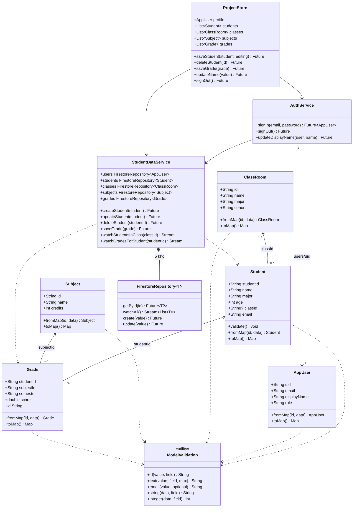
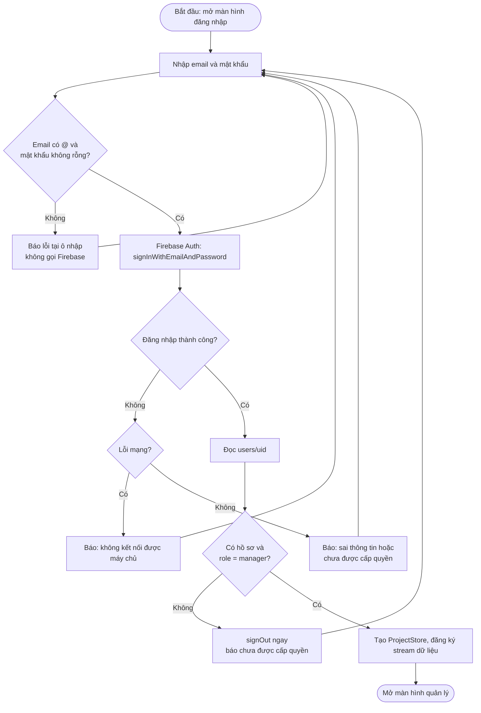
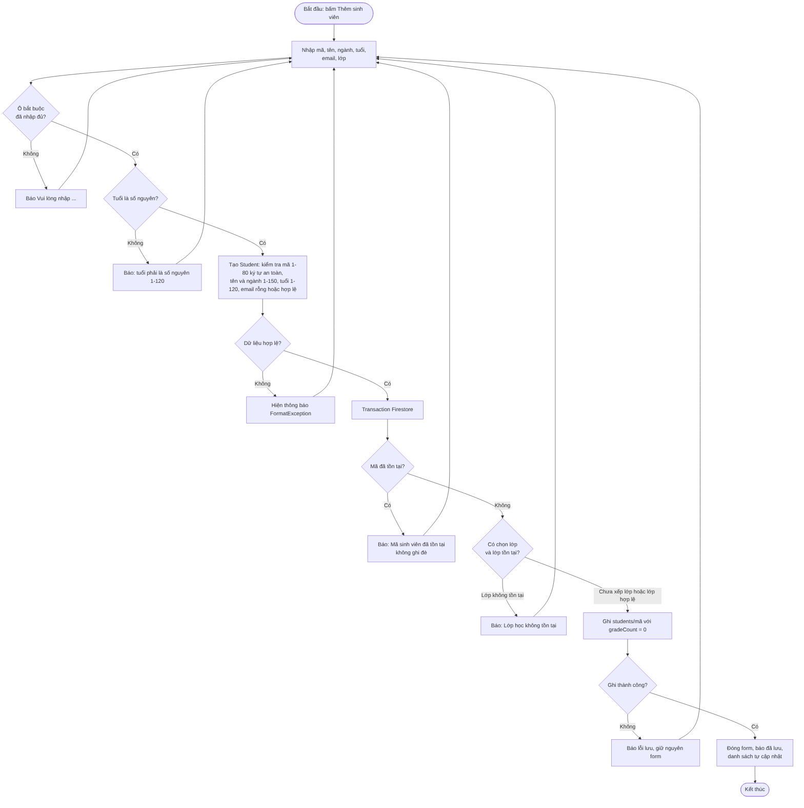
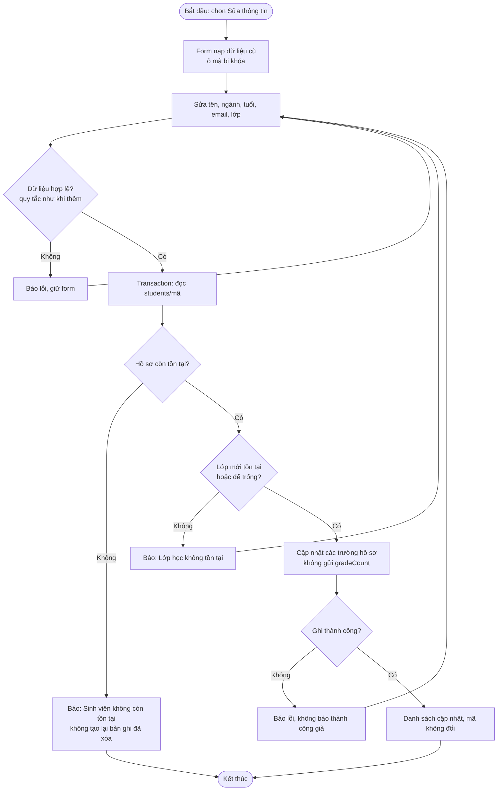
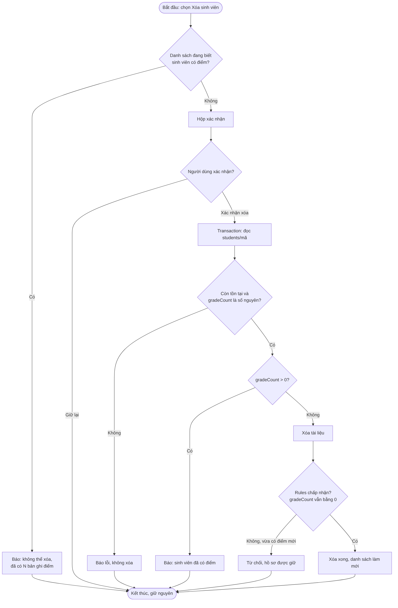
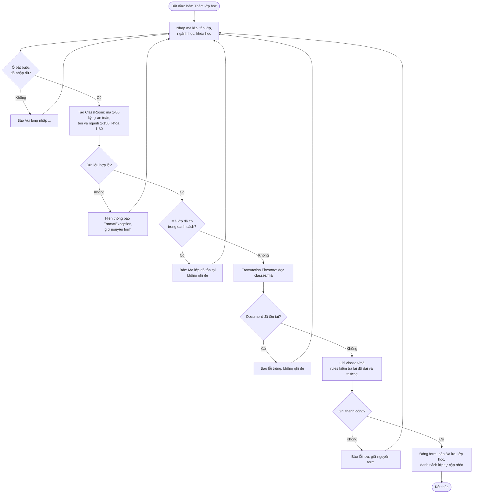
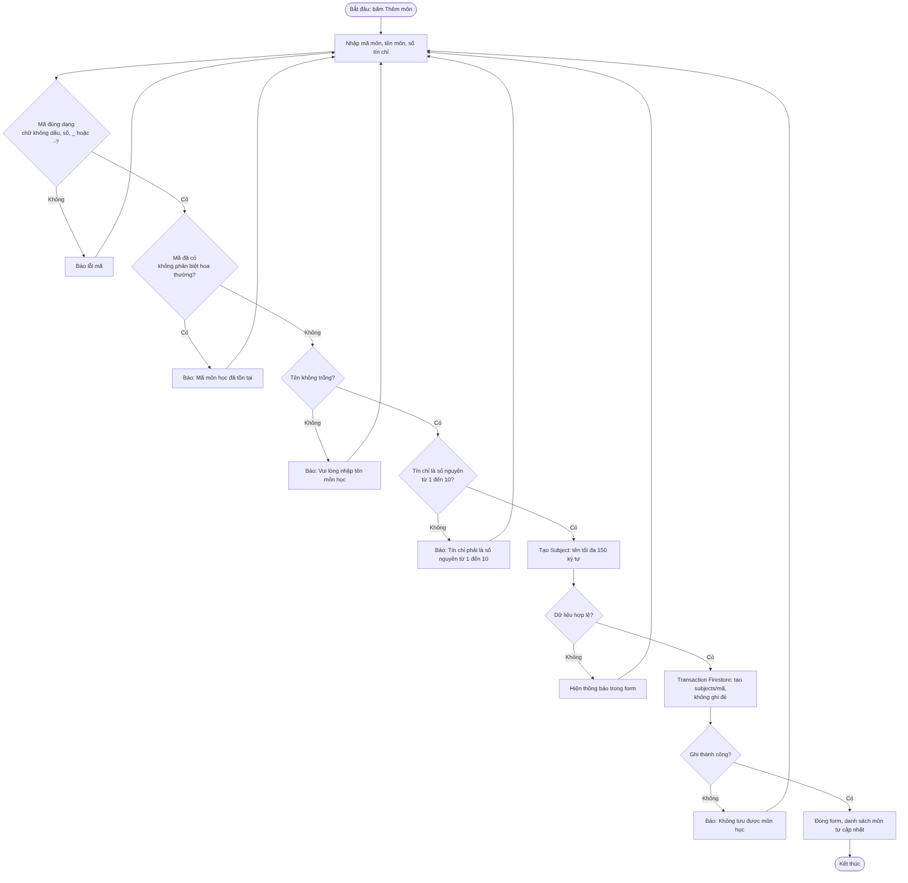
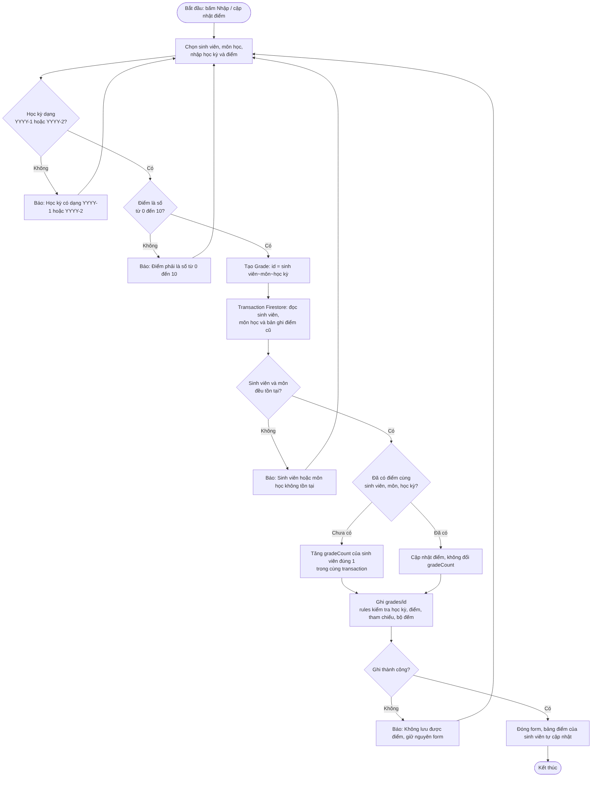

# Class Diagram và sơ đồ thuật toán

Nguồn Mermaid nằm trong `docs/diagrams/*.mmd`; ảnh PNG được render từ các file đó.
Sửa file `.mmd` rồi render lại bằng `mmdc -i <file>.mmd -o <file>.png -b white -s 2`.

## Class Diagram (G1-03)

| Lớp | Thuộc tính | Phương thức / vai trò |
|---|---|---|
| AppUser | uid, email, displayName, role | fromMap, toMap. Chỉ là hồ sơ; mật khẩu do Firebase Auth quản lý. |
| Student | studentId, name, major, age, classId (null = chưa xếp lớp), email | validate, fromMap, toMap. Bất biến: sửa hồ sơ tạo đối tượng mới. |
| ClassRoom | id, name, major, cohort | fromMap, toMap |
| Subject | id, name, credits | fromMap, toMap |
| Grade | studentId, subjectId, semester, score; getter id = `studentId~subjectId~semester` | fromMap (kiểm tra id khớp), toMap |
| ModelValidation | không có | id, text, email, string, integer: kiểm tra trước khi ghi |
| FirestoreRepository&lt;T&gt; | collection, encode, idOf | getById, watchAll, create (transaction, không ghi đè), update (không tạo lại bản ghi đã xóa) |
| StudentDataService | 5 repository: users, students, classes, subjects, grades | createStudent, updateStudent, deleteStudent, saveGrade, watchStudentsInClass, watchGradesForStudent |
| AuthService | auth, data | signIn, signOut, updateDisplayName |
| ProjectStore | profile, students, classes, subjects, grades | saveStudent, deleteStudent, saveGrade, updateName, signOut; chế độ demo hoặc cloud |

Quan hệ: ClassRoom 0..1 — 0..* Student (qua classId); Student 1 — 0..* Grade;
Subject 1 — 0..* Grade; Student và Subject là quan hệ n–n thông qua Grade, phân biệt bằng học kỳ.
Trường `gradeCount` chỉ có trong document Firestore của sinh viên, không nằm trong lớp Student.

## Sơ đồ thuật toán

### Đăng nhập (US01)

### Thêm sinh viên (US06)

### Sửa sinh viên (US07)

### Xóa sinh viên (US08)

### Tạo lớp (US10)

### Thêm môn học (US14)

### Lưu điểm (US15)

Mỗi nhánh trong sơ đồ tương ứng với một ca test trong `test/` (model, store, màn hình)
hoặc `tools/firestore-tests/rules.test.mjs`.
