# Tài liệu code: module Tài khoản và Sinh viên

Phạm vi: US01–US08. Người phụ trách sau khi tách nhóm: Nguyễn Bá Phát (phần của Nguyễn Văn Bắc
và Nguyễn Bá Phát trong kế hoạch). Ngày cập nhật: 30/10/2026.

## 1. Các file chính

| Lớp | File | Vai trò |
|---|---|---|
| Model | `lib/models/app_user.dart` | Hồ sơ người quản lý (uid, email, displayName, role). Không chứa mật khẩu. |
| Model | `lib/models/student.dart` | Hồ sơ sinh viên bất biến; `validate()` kiểm tra trước khi ghi. |
| Model | `lib/models/model_validation.dart` | Hàm kiểm tra dùng chung: mã, văn bản, email, số nguyên. |
| Dịch vụ | `lib/services/auth_service.dart` | `signIn`, `signOut`, `updateDisplayName` trên Firebase Auth. |
| Dịch vụ | `lib/services/student_data_service.dart` | `createStudent`, `updateStudent`, `deleteStudent`, `saveGrade`, truy vấn theo lớp/sinh viên. |
| Dịch vụ | `lib/services/firestore_repository.dart` | Kho dữ liệu có kiểu: `create` (không ghi đè), `update` (không tạo lại bản ghi đã xóa), `watchAll`. |
| Trạng thái | `lib/services/project_store.dart` | Giữ dữ liệu hiển thị. Hai chế độ: `demo` (lưu trên máy) và `cloud` (Firebase). |
| Giao diện | `lib/screens/project_login_screen.dart` | Đăng nhập (US01). |
| Giao diện | `lib/screens/project_workspace.dart` | Danh sách, form thêm/sửa, xóa sinh viên (US05–US08); hồ sơ, sửa tên, đăng xuất (US02–US04). |
| Giao diện | `lib/ui/record_form.dart` | Form nhập dữ liệu dùng chung, hiện lỗi khi lưu thất bại. |
| Quyền | `firestore.rules` | Kiểm tra lại dữ liệu và quyền ở phía máy chủ. |

## 2. Ánh xạ Firestore

| Collection | Document ID | Trường |
|---|---|---|
| `users` | uid của Firebase Auth | `email`, `displayName`, `role` (`manager`) |
| `students` | mã sinh viên | `name`, `major`, `age`, `classId` (null nếu chưa xếp lớp), `email`, `gradeCount` |

- ID nằm ở đường dẫn document, không lưu lặp trong dữ liệu.
- `gradeCount` chỉ tồn tại trong document Firestore, không nằm trong lớp `Student`. Đây là bộ đếm số bản ghi
  điểm của sinh viên, dùng để xóa an toàn (mục 4).
- `Student.fromMap` / `toMap` giữ nguyên cấu trúc; `createStudent` thêm `gradeCount: 0` khi ghi.
- `Student` không có giá trị mặc định: `studentId`, `name`, `major`, `age` là bắt buộc; chỉ `classId` (null) và
  `email` (rỗng) có thể bỏ qua. Test dùng hàm `sampleStudent()` trong `test/support/sample_data.dart`
  với dữ liệu giả (`SV001`, `Sinh viên Mẫu`).

## 3. Quy tắc dữ liệu (US06, US07)

| Trường | Quy tắc |
|---|---|
| Mã sinh viên | 1–80 ký tự `A–Z a–z 0–9 _ -`, không đổi sau khi tạo, không trùng |
| Họ tên, ngành | Không trống, tối đa 150 ký tự |
| Tuổi | Số nguyên 1–120 |
| Email | Để trống hoặc đúng dạng địa chỉ, tối đa 254 ký tự |
| Lớp | Để trống (chưa xếp lớp) hoặc là lớp đã tồn tại |

Quy tắc được kiểm tra ba lần: trong lớp `Student` (trước khi ghi), trong transaction của
`StudentDataService`, và trong `firestore.rules` (phía máy chủ, kể cả khi client bỏ qua service).

## 4. Xóa sinh viên an toàn (US08)

Vấn đề: nếu chỉ đọc danh sách điểm ở client rồi xóa, một điểm mới được nhập cùng lúc sẽ trở thành điểm mồ côi.

Cách xử lý:
1. `createStudent` ghi `gradeCount = 0`.
2. `saveGrade` tăng `gradeCount` đúng 1 trong **cùng transaction** khi tạo điểm mới; sửa điểm cũ không đổi bộ đếm.
3. `updateStudent` chỉ gửi các trường hồ sơ, không gửi `gradeCount`, nên bản sao cũ không ghi đè được bộ đếm.
4. `deleteStudent` đọc và xóa trong một transaction, từ chối nếu `gradeCount > 0` hoặc hồ sơ không có bộ đếm.
5. Rules chỉ cho `delete` khi `gradeCount == 0`; chỉ cho tạo điểm khi bộ đếm của sinh viên tăng đúng 1 trong cùng lần ghi.

Giao diện: hỏi xác nhận trước khi xóa; sinh viên đã có điểm bị chặn ngay, kèm số bản ghi điểm.

## 5. Luồng và sơ đồ

Sơ đồ nằm ở [09-class-diagram-va-so-do.md](09-class-diagram-va-so-do.md): Class Diagram, đăng nhập, thêm, sửa, xóa sinh viên.

## 6. Ảnh minh chứng

**Bản trình diễn** (dữ liệu mẫu lưu trên trình duyệt, không ghi Firebase). Bảng mô tả ở
[screenshots/README.md](screenshots/README.md).

| Story | Ảnh |
|---|---|
| US01 | 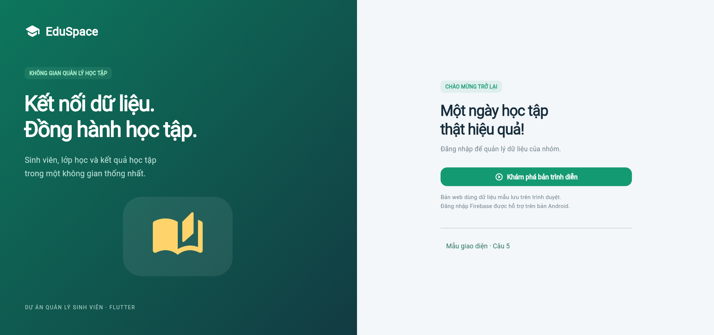 |
| US05 | 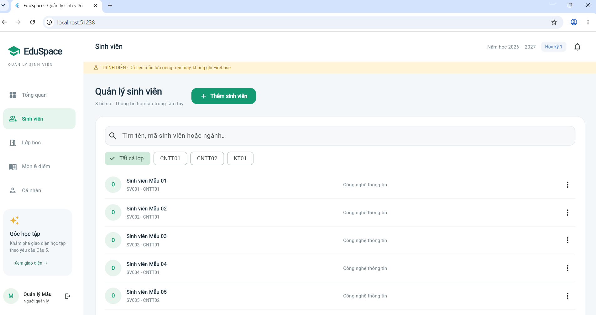 |
| US06 | 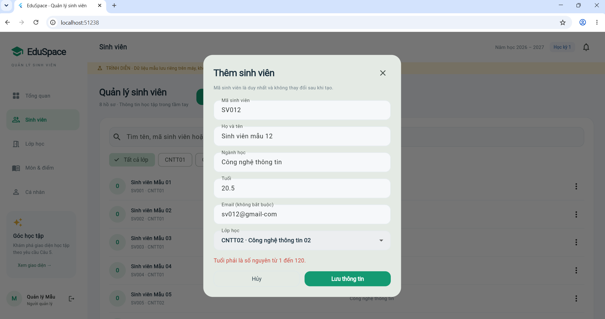 |
| US08 | 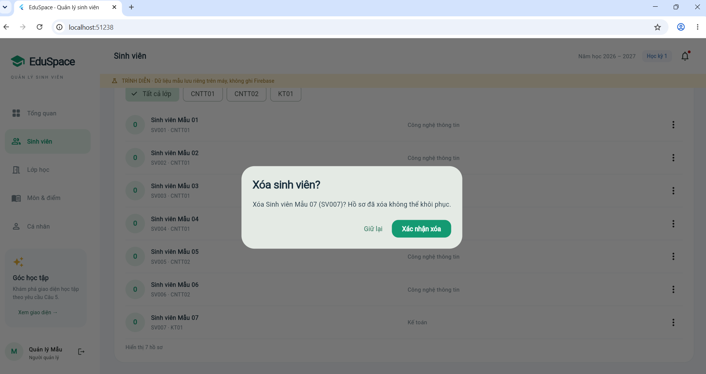 |
| US08 | 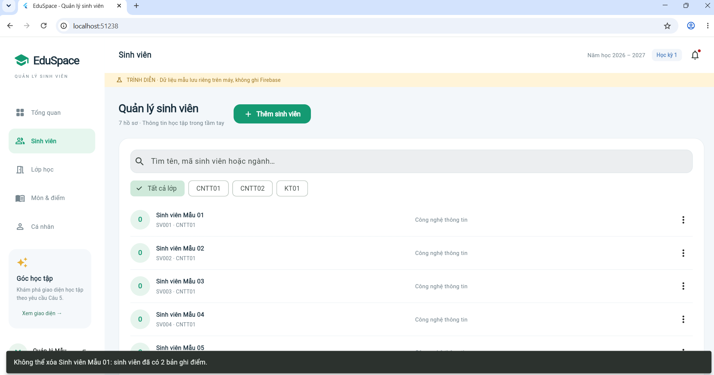 |
| US02–US04 | 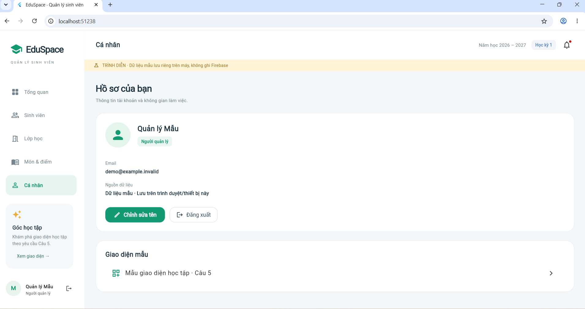 |

**Firebase thật** (31/10/2026, bản web, project `qlsv-n05-phat-khoi`). Bảng mô tả ở
[screenshots/firebase-that/README.md](screenshots/firebase-that/README.md).

| Bước | Ảnh |
|---|---|
| Đăng nhập sai | 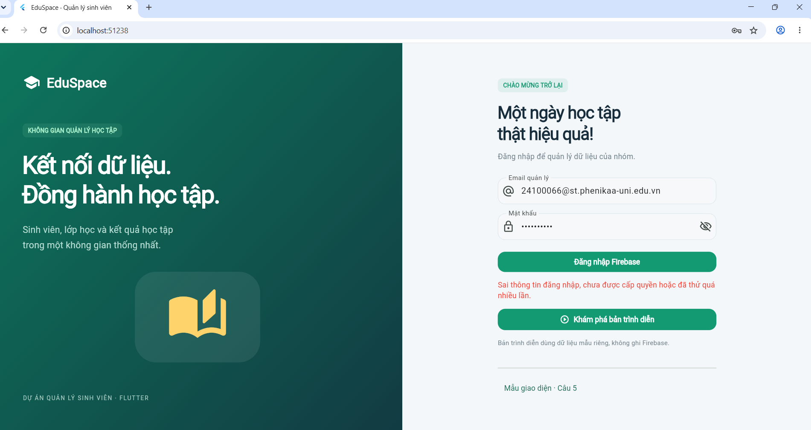 |
| Đăng nhập thành công | 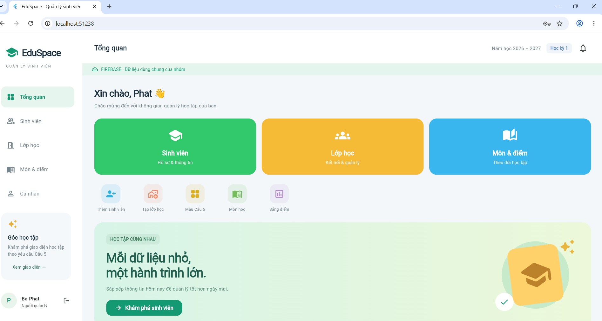 |
| Lớp học | 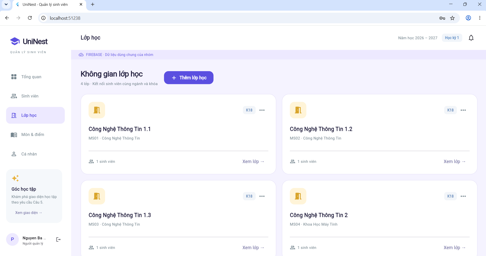 |
| Sinh viên gắn lớp | 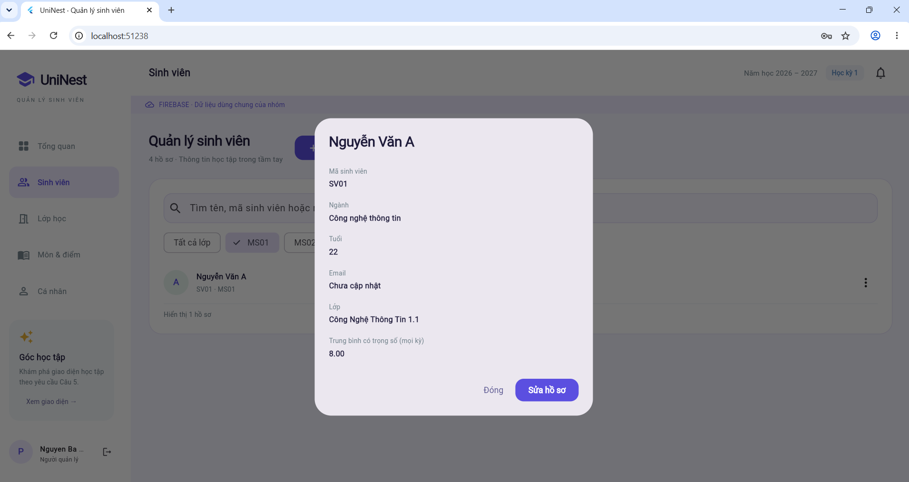 |
| Môn học | 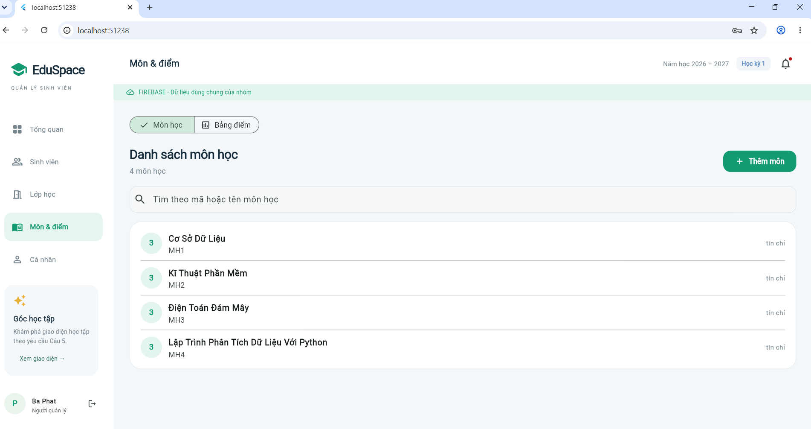 |
| Nhập điểm | 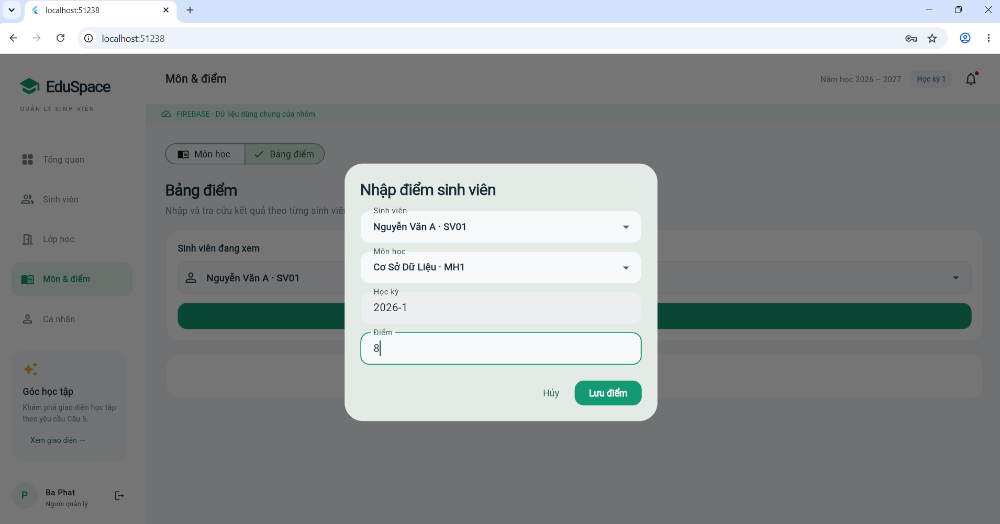 |
| Chặn xóa sinh viên có điểm | 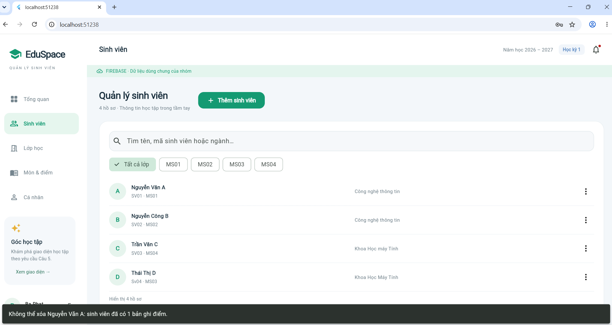 |
| Xóa sinh viên chưa có điểm | 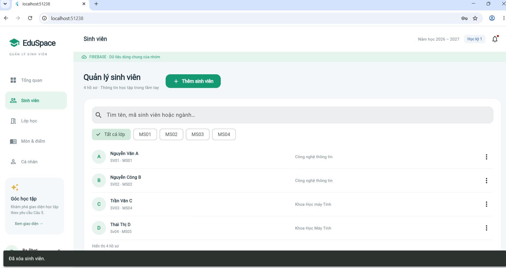 |
| Đổi tên hiển thị | 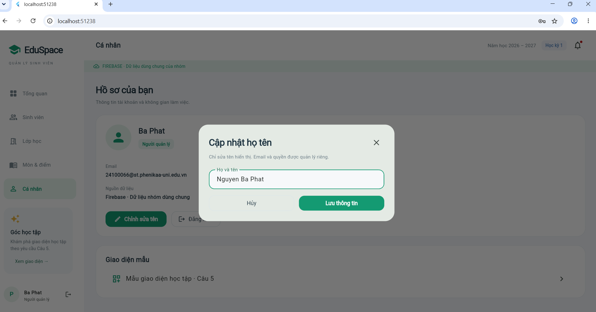 |
| Console: hồ sơ `users` | 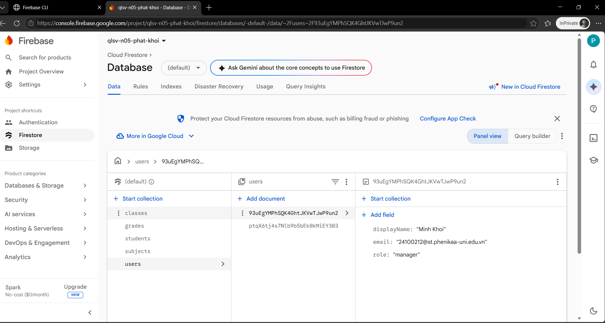 |
| Console: `subjects` | 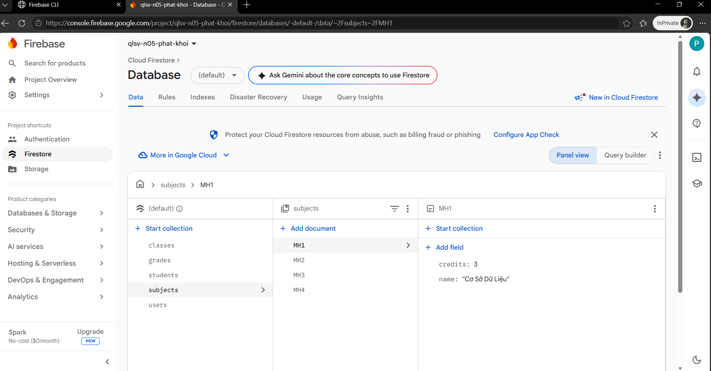 |
| Console: `grades` | 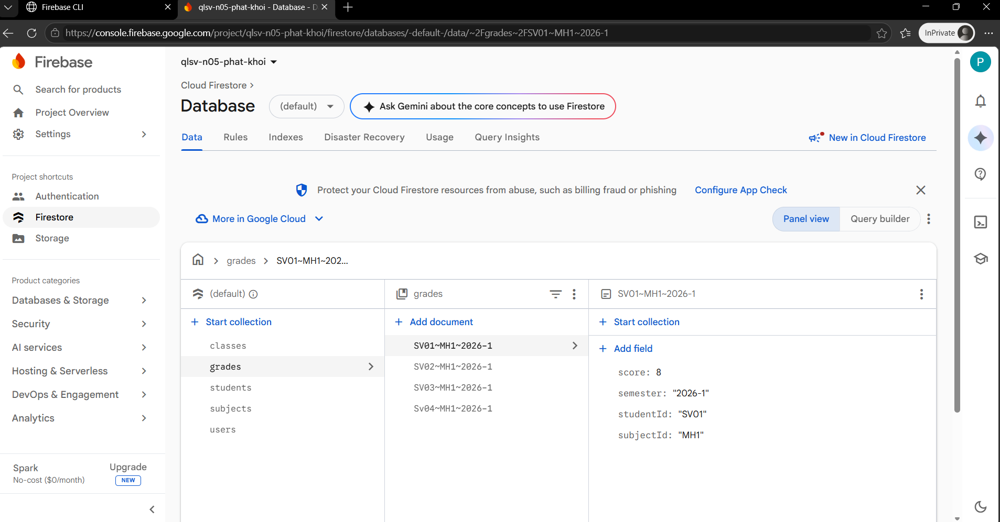 |
| Console: `students` có `gradeCount` | 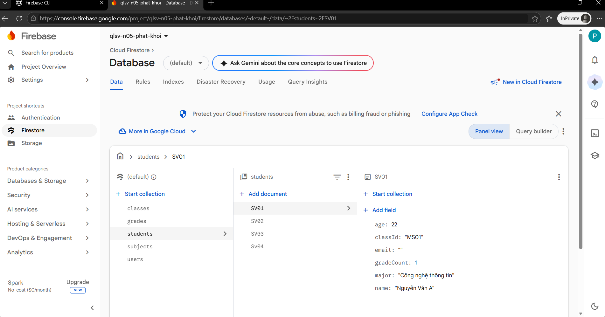 |
| Console: `classes` | 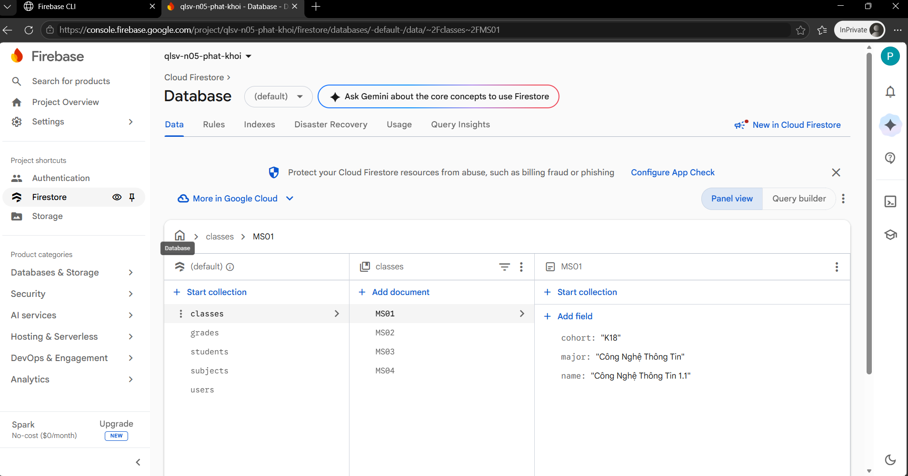 |

## 7. Kiểm thử theo story

| Story | Test tự động |
|---|---|
| US01 | `test/auth_service_test.dart` (đăng nhập đúng, thiếu hồ sơ, sai vai trò, sai mật khẩu); `test/login_screen_test.dart` (trường trống, sai mật khẩu, lỗi mạng, tài khoản không có quyền, vào được màn hình quản lý); rules: khách và tài khoản chưa cấp quyền bị chặn |
| US02 | `test/auth_service_test.dart`; `test/login_screen_test.dart` (đăng xuất về đăng nhập); `test/project_store_test.dart` (đăng xuất hủy stream và xóa dữ liệu; đăng xuất lỗi giữ nguyên phiên) |
| US03 | `test/cloud_flow_test.dart` (hồ sơ được tải sau đăng nhập); chưa có widget test riêng cho màn hình hồ sơ, chỉ có ảnh minh chứng |
| US04 | `test/auth_service_test.dart` (cắt khoảng trắng, từ chối tên trống hoặc quá 150 ký tự, không tạo lại hồ sơ thiếu); `test/cloud_flow_test.dart`; rules: chỉ sửa được `displayName` của chính mình |
| US05 | `test/project_workspace_test.dart` (tìm kiếm, lọc lớp, danh sách rỗng, nhận sinh viên mới); `test/project_store_test.dart` (theo dõi thay đổi dữ liệu) |
| US06 | `test/models_test.dart` (biên tuổi, độ dài, email, mã); `test/project_workspace_test.dart` (mã trùng, email sai, ô bắt buộc, tuổi không nguyên); `test/student_data_service_test.dart` (không ghi đè, lớp không tồn tại) |
| US07 | `test/student_data_service_test.dart` (đổi lớp cập nhật cả hai danh sách, bỏ lớp, đổi lớp lỗi giữ lớp cũ, không tạo bản ghi trùng); `test/project_store_test.dart` (sửa giữ `gradeCount`) |
| US08 | `test/student_data_service_test.dart` (bộ đếm, xóa an toàn); `test/project_workspace_test.dart` (hủy, xác nhận, chặn khi có điểm); `test/project_store_test.dart` (danh sách cũ không vượt qua được transaction); `test/cloud_flow_test.dart`; `tools/firestore-tests/rules.test.mjs` (xóa khi chưa/đã có điểm, tạo điểm sai bộ đếm) |
| Tích hợp | `test/cloud_flow_test.dart`: đăng nhập, tạo lớp, môn, sinh viên, điểm, xóa bị chặn, đổi tên, đăng xuất, và phiên thứ hai thấy dữ liệu của phiên đầu |

## 8. Kết quả kiểm tra đã ghi nhận

Ngày 30/10/2026, máy Windows, Flutter 3.47.8:
- `flutter analyze`: không có vấn đề.
- `flutter test`: 74 test qua, đã gồm các test của G4-01/G4-02 ở mục 7.
- Firestore Emulator (project giả `demo-qlsv`, Java 21.0.13, Node 24.21.0): 11 test qua, 0 lỗi.

Sau đó model `Student` được bỏ giá trị mặc định và các test chuyển sang `sampleStudent()`. Chạy lại
ngày 31/10/2026: `flutter analyze` không có vấn đề, `flutter test` 74 test qua.

Ngày 31/10/2026, bản web (Chrome) với Firebase thật, project `qlsv-n05-phat-khoi`: đăng nhập sai bị từ chối,
đăng nhập đúng vào được, tạo lớp, môn học, sinh viên, nhập điểm, sinh viên có điểm bị chặn xóa, sinh viên chưa
có điểm xóa được, đổi tên hiển thị (ảnh ở mục 6).

## 9. Hạn chế đã biết

- Ứng dụng dùng project Firebase riêng của nhóm `qlsv-n05-phat-khoi` (Spark, Firestore `asia-southeast1`).
- Hồ sơ sinh viên tạo trước thay đổi bộ đếm chưa có `gradeCount`, nên chưa sửa, xóa hoặc nhập điểm được cho đến khi bổ sung trường này.
- Nghiệm thu với Firebase thật mới chạy trên bản web (Chrome); chưa chạy trên Android vì không có thiết bị.
- Xóa lớp, môn và điểm vẫn bị rules khóa (ngoài phạm vi các story hiện tại).
- Validator học kỳ (chỉ nhận dạng `2026-1`, `2026-2`) thuộc US15, chưa xử lý ở đây.
