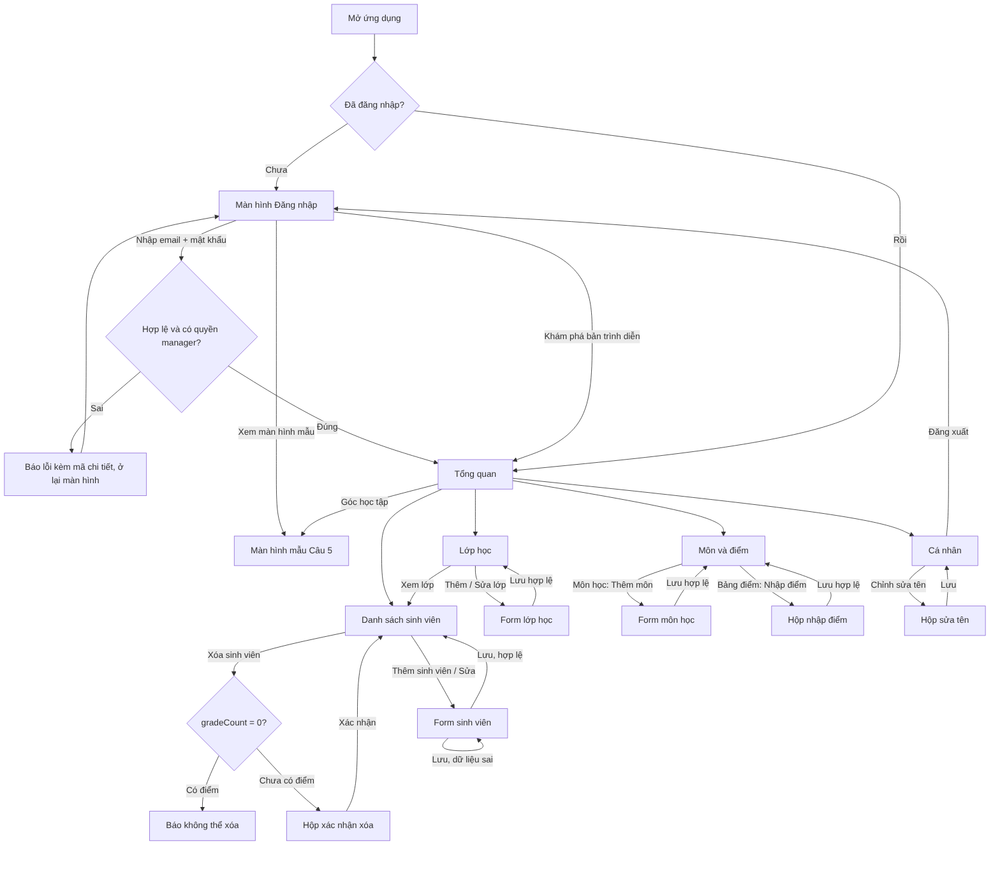

# Câu 4 — Wireframe và luồng công việc của các màn hình

Có 9 wireframe (vẽ bằng HTML, nguồn `docs/wireframes/wireframes.html`, ảnh PNG cùng thư mục) và 1 sơ đồ luồng tổng thể `docs/diagrams/flow-man-hinh.png`. Đề yêu cầu tối thiểu 5 màn hình cho mỗi phần.

| # | Màn hình | Wireframe | Luồng công việc (Flow of work) |
|---|---|---|---|
| 1 | Đăng nhập | wireframes/01-dang-nhap.png | Nhập email + mật khẩu → kiểm tra → vào Tổng quan; sai thì báo lỗi kèm mã chi tiết. Có lối "Khám phá bản trình diễn" và "Xem màn hình mẫu". |
| 2 | Tổng quan | wireframes/02-tong-quan.png | Số liệu sinh viên, lớp, môn; "Xem tất cả" sang danh sách sinh viên; "Góc học tập" sang Câu 5. |
| 3 | Danh sách sinh viên | wireframes/03-danh-sach-sinh-vien.png | Tìm kiếm + lọc lớp; menu ⋮: xem, sửa, xóa; nút Thêm sinh viên. |
| 4 | Form thêm/sửa sinh viên | wireframes/04-form-sinh-vien.png | Nhập → kiểm tra từng trường → dữ liệu sai thì giữ nguyên form và báo lỗi → hợp lệ thì lưu và quay lại danh sách. |
| 5 | Xác nhận xóa sinh viên | wireframes/05-xac-nhan-xoa.png | Có điểm (gradeCount > 0) thì chặn; chưa có điểm thì hỏi xác nhận rồi xóa. |
| 6 | Lớp học | wireframes/06-lop-hoc.png | Danh sách lớp; thêm/sửa lớp; "Xem lớp" lọc sinh viên theo lớp. |
| 7 | Môn & điểm | wireframes/07-mon-va-diem.png | Hai tab Môn học / Bảng điểm; thêm môn; nhập điểm (học kỳ YYYY-1/YYYY-2, điểm 0–10). |
| 8 | Cá nhân | wireframes/08-ca-nhan.png | Xem hồ sơ, sửa tên hiển thị, đăng xuất về màn hình đăng nhập. |
| 9 | Mẫu giao diện Câu 5 | wireframes/09-mau-cau-5.png | Bố cục học tập theo mẫu giáo viên chọn; chỉ hiển thị, các ô mở hộp thoại thông tin. |

Sơ đồ luồng tổng thể: 

Luồng chi tiết từng thao tác (Sequence/Activity) nằm ở docs/09: đăng nhập, thêm, sửa, xóa sinh viên, tạo lớp, thêm môn, lưu điểm.

## Đối chiếu wireframe với giao diện thật

Ảnh giao diện thật nằm ở `docs/screenshots/` (bản demo) và `docs/screenshots/firebase-that/` (Firebase thật). Wireframe vẽ theo bố cục điện thoại; trên máy tính app dùng thanh điều hướng bên trái thay cho thanh dưới, cùng các mục và cùng luồng.
